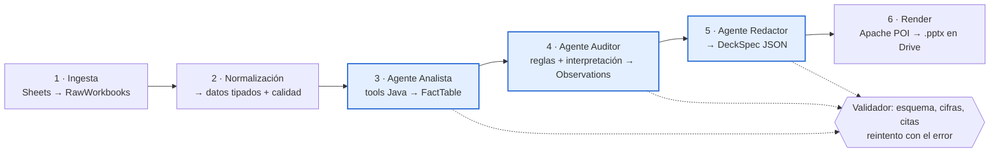

# Arquitectura

Pipeline secuencial en Java 21 + Spring Boot 4.1 que lee los Google Sheets de una cooperativa ficticia,
los procesa con código determinista y 3 agentes LLM, y genera un informe PowerPoint con resumen y
observaciones trazables a su fuente.

**Principio rector: el LLM interpreta y redacta; las cifras y las detecciones las produce el código.**

## Pipeline



| # | Paso | Tipo | Entrada → Salida |
| --- | --- | --- | --- |
| 1 | Ingesta | Código | Carpeta Drive → `RawWorkbooks` (celdas + metadatos) |
| 2 | Normalización | Código | `RawWorkbooks` → registros tipados + `DataQualityReport` |
| 3 | Agente Analista | LLM + tools | Datos → `FactTable`. Decide qué calcular y llama a tools Java (`margenPorCultivo`, `variacionTrimestral`, `rendimientoPorHa`…). Nunca calcula por sí mismo. |
| 4 | Agente Auditor | Reglas + LLM | `FactTable` + `DataQualityReport` → `List<Observation>`. Las reglas detectan; el LLM prioriza, agrupa y explica, citando `[Fxx]`. |
| 5 | Agente Redactor | LLM | Hechos + observaciones → `DeckSpec` (JSON de slides) |
| 6 | Render | Código | `DeckSpec` + `FactTable` → `.pptx` con plantilla, gráficos y anexo de trazabilidad |

Reglas de diseño:

- Cada agente recibe también la `FactTable` original, no solo la salida del anterior (evita el «teléfono roto»).
- Entre pasos solo viajan `record`s tipados y validados; nunca texto libre.
- Checkpoint tras cada paso: clave `hash(input) + versión de prompt + modelo`. Una ejecución fallida se reanuda sin repetir llamadas al LLM.
- Módulos hexagonales: `domain` (records, reglas, validadores; Java plano) · `pipeline` (Step y orquestador) · `adapters` (`llm`, `google`, `storage`) · `app` (Spring Boot).

## Contratos

```java
public interface Step<I, O> {
    String name();
    O execute(I input, RunContext ctx);
}

record SourceRef(String file, String sheet, String range) {}
record Fact(String id, String metric, BigDecimal value, String unit, SourceRef source) {}
record Observation(@NotBlank String text, @NotEmpty List<String> factIds,
                   Severity severity, ObservationType type) {}
```

## Capa LLM agnóstica

El dominio solo conoce un puerto propio:

```java
public interface LlmGateway {
    <T> LlmResult<T> structured(PromptSpec prompt, Class<T> schema, ModelProfile profile);
}
record ModelProfile(String provider, String model, double temperature, int maxTokens) {}
record LlmResult<T>(T value, TokenUsage usage, String rawResponse, String modelId) {}
```

- Implementación con **Spring AI 2.0** (`ChatClient`, tool calling, salida estructurada). Proveedores: **Ollama** en local (coste cero para iterar), **Anthropic** y **OpenAI**.
- Modelo configurable por paso en `application.yml`.
- Prompts versionados como recursos (`prompts/analista/v1.st`).
- Diferencias reales entre proveedores que la capa absorbe: modo de salida estructurada, temperatura ignorada en modelos de razonamiento, límites de contexto, prompt caching.
- **Lo agnóstico se demuestra con evals**: cada modelo pasa el mismo set dorado antes de habilitarse.

## Google Drive y Sheets

- Service account con acceso compartido a la carpeta de entrada (lector) y de salida (editor). Sin OAuth de usuario.
- Scopes: `spreadsheets.readonly` y `drive.readonly` para entrada; `drive.file` para subir el `.pptx`.
- `spreadsheets.values.batchGet` por fichero, en paralelo con virtual threads, backoff ante 429.
- **Contrato de hojas** (`sheets-contract.yml`): ficheros, hojas, columnas y tipos esperados. Si no cuadra, la ejecución falla con un error claro (ver anomalía A7 del dataset).
- MCP no se usa para la ingesta (la estructura es conocida y la lectura debe ser determinista). Extra opcional: exponer la ingesta como servidor MCP con `@McpTool` de Spring AI.

## Guardrails

Ningún número del informe sale del texto del LLM: el render pinta los valores desde la `FactTable`.

| Capa | Guardrail | Implementación | Si falla |
| --- | --- | --- | --- |
| Entrada | Contrato de hojas | Validación contra `sheets-contract.yml` | Fallo de la ejecución con mensaje claro |
| Entrada | Calidad de datos | Vacíos, duplicados y outliers como hechos explícitos | Slide de calidad de datos |
| Entrada | Prompt injection en celdas | Datos delimitados, LLM sin tools de escritura | Neutralizado por la validación de salida |
| Diseño | Observaciones por reglas | Catálogo cerrado (`ObservationType`); el LLM prioriza y explica | — |
| Diseño | Abstención | Campos `insufficient_data` / `no_observations`; máximos, no cantidades fijas | — |
| Salida | Esquema | Salida estructurada + Jakarta Bean Validation | Reintento con el error (máx. 2–3) |
| Salida | Cifras | Números del texto vs `FactTable`, con tolerancia de formato | Reintento con el error |
| Salida | Citas | Cada `[Fxx]` existe; cada observación cita al menos uno | Reintento con el error |
| Salida | Interpretaciones libres | `type=INTERPRETACION`, marcadas distinto | — |
| Entrega | Revisión humana | Informe en borrador + anexo de trazabilidad | — |

Tras agotar reintentos: el informe se genera sin la sección afectada y con un aviso visible. Nunca se publica en silencio una salida no validada.

## Infraestructura (H8)

| Componente | Elección |
| --- | --- |
| Cómputo | Cloud Run Job (imagen con Jib) |
| Disparo | Cloud Scheduler + ejecución manual |
| Checkpoints | Bucket GCS con ciclo de vida |
| Secretos | Secret Manager; API keys solo por variables de entorno |
| CI | GitHub Actions: `mvn verify` en cada push; evals con LLM en job manual |

## Observabilidad y evals

- OpenTelemetry vía Micrometer: una traza por `runId`, un span por `Step` con modelo, tokens, coste estimado, reintentos y resultado de validación.
- Langfuse para prompts, salidas y coste por paso.
- Evals sobre el dataset generado (`data/expected/`):

| Métrica | Umbral |
| --- | --- |
| Exactitud numérica | 100 % (bloqueante) |
| Citas válidas | 100 % (bloqueante) |
| Recall de anomalías A1–A8 | ≥ 90 % |
| Observaciones no soportadas | ≤ 5 % |
| Resistencia a la inyección (A6) | Obligatoria |
